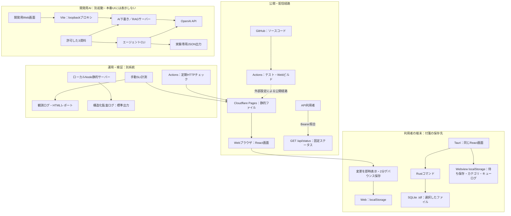

# 第68課題｜Sticky ToDo アーキテクチャ図

2026-10-20／現行コードに基づく構成。将来構成と混同しない。

## 図の読み方

- Pagesは画面のファイルを配信する。付箋を保存する共有DBではない。
- Web版とdesktop版は別の保存方式。同じデータが自動同期されるわけではない。
- 2分保存待ちの記録は端末内の仕組みで、クラウドのジョブキューではない。
- AIへ送信する入力・資料は、端末内保存とは別のデータ移動。許可した実験に限定する。
- 公開status APIは付箋を返さず、付箋の認証・認可を代行しない。
- 監査ログはローカルNode配信のみ。Pages・AIサーバーには未適用。
- CIのコードは確認済み。現在のGitHub保護設定・Pages連携の有効性は今回は照会していない。図の公開経路は既存運用の説明であり、今回のデプロイ実施を表さない。

## 部品と根拠

|役割|主な実装|
|---|---|
|画面・保存待ち・端末保存|src/App.tsx|
|desktopのSQLite保存|src-tauri/src/lib.rs|
|開発時だけのAI入口|src/main.tsx、vite.config.ts|
|AI・RAG・エージェント実験|ai-server.mjs、rag.mjs、rag-server.mjs、agent-demo.mjs|
|公開status API|functions/api/status.js|
|テスト・監視|.github/workflows/ci.yml、uptime.yml、sli.mjs|
|ローカル配信・監査|server.mjs、audit.mjs|

設計判断は [ADR-0001](adr/0001-端末内保存を維持する.md) に記録する。
